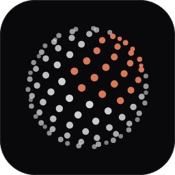
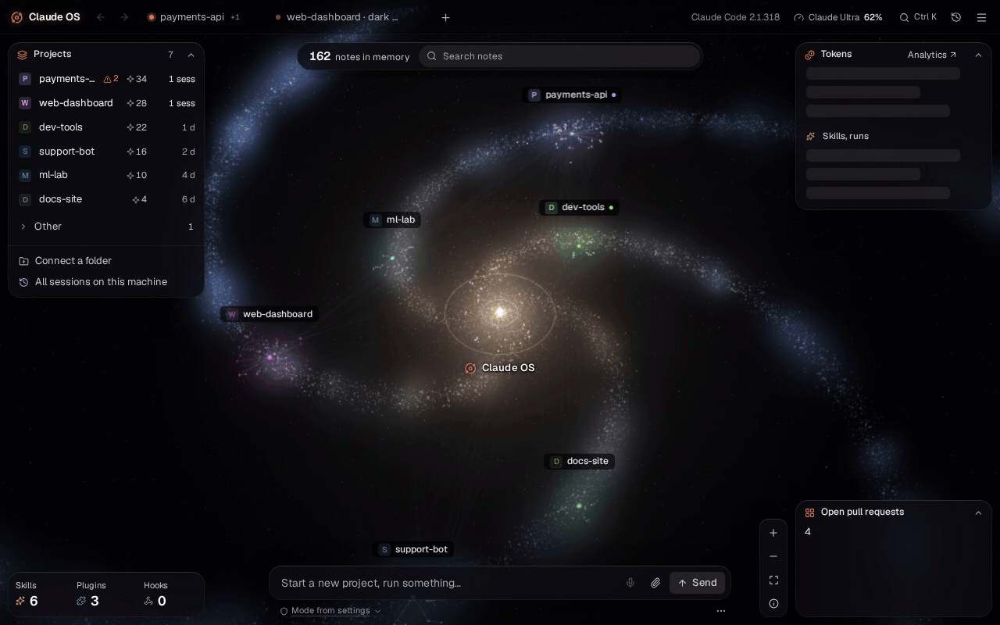
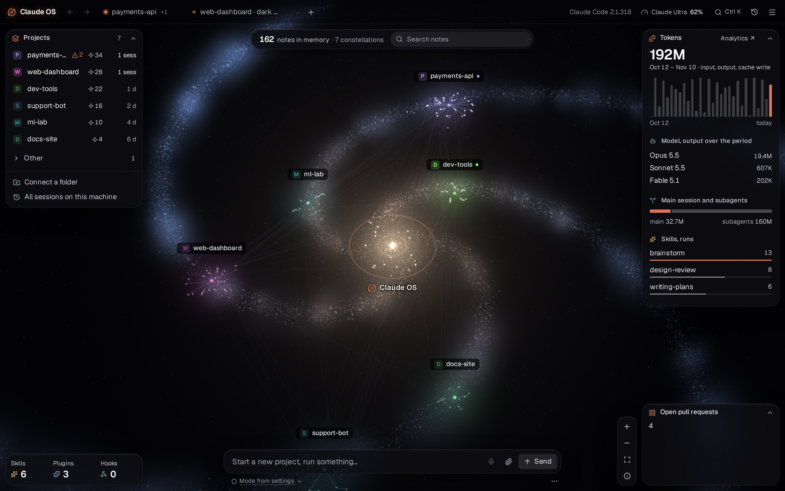
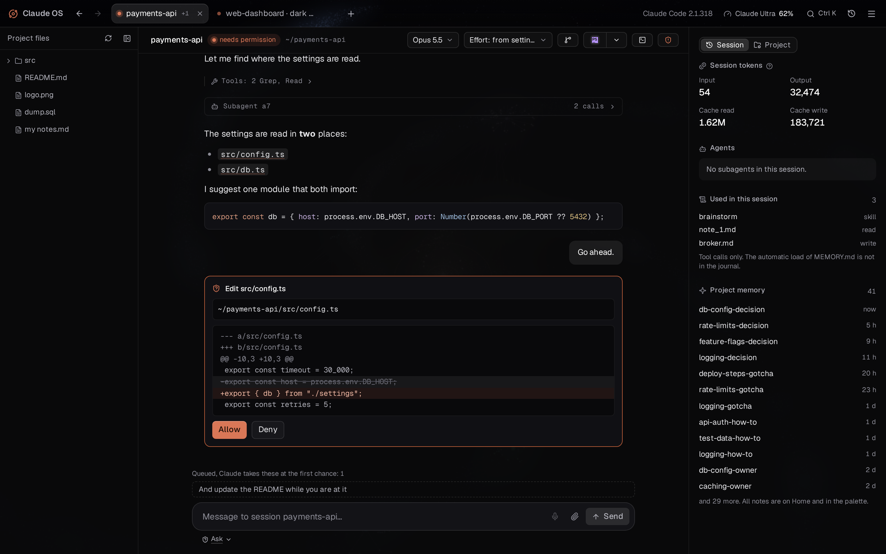
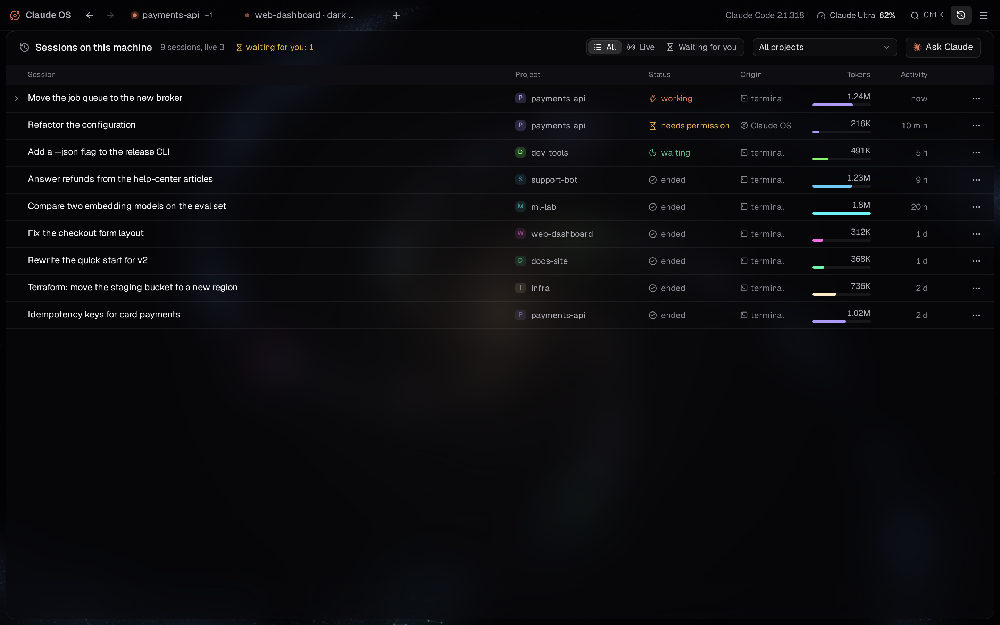
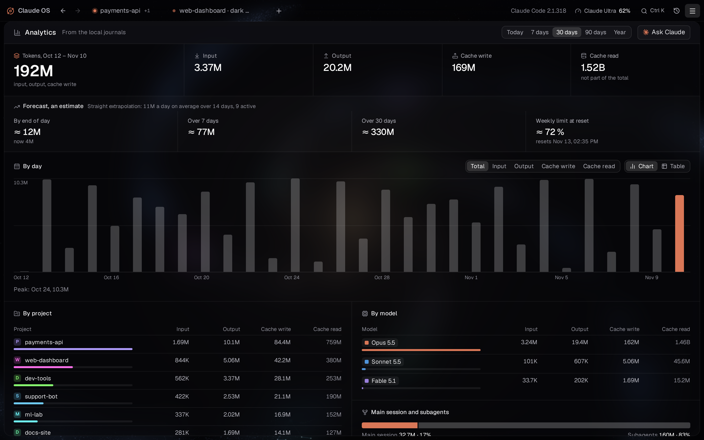
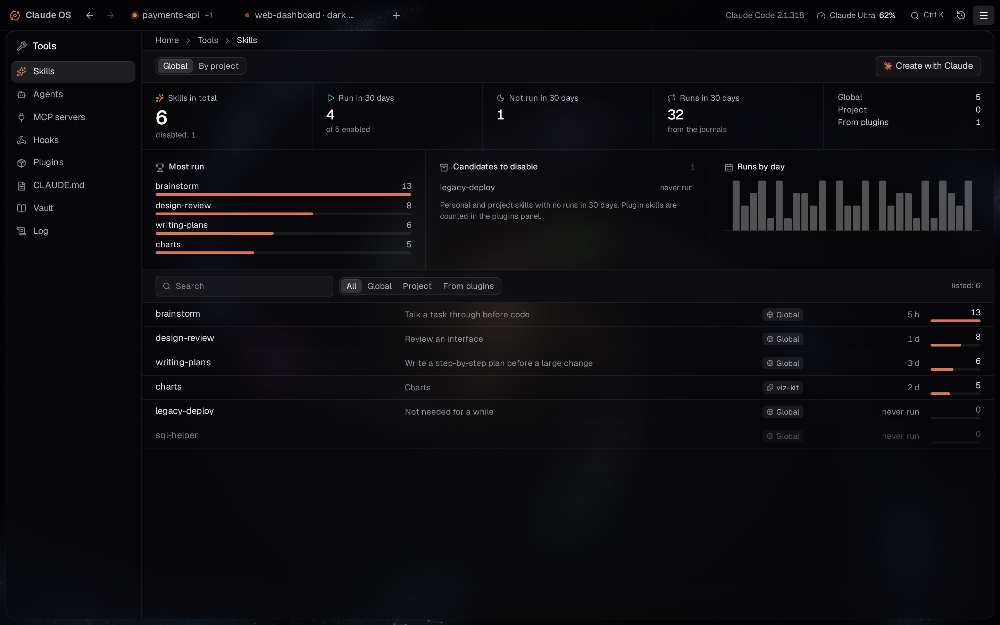
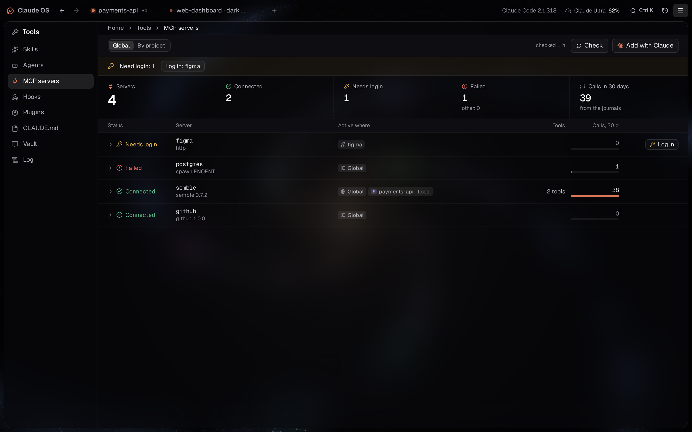
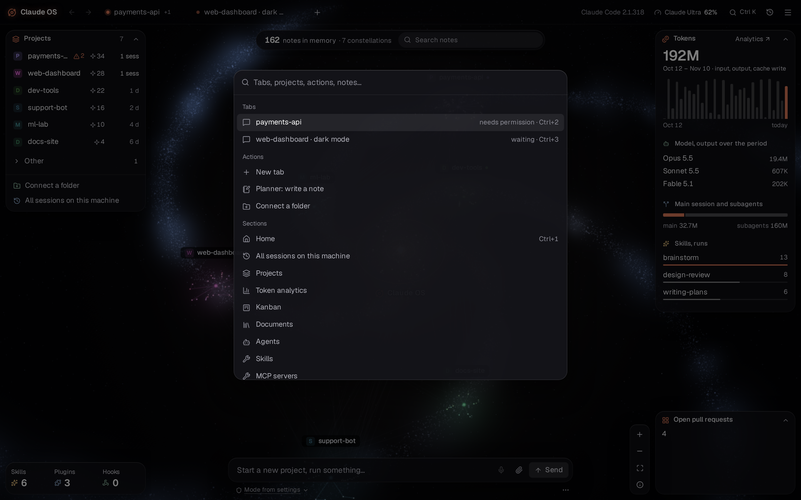
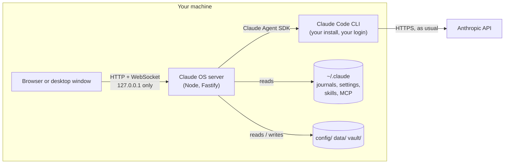

<div align="center">



# Claude OS

**A local workspace for Claude Code: every project, session, note and tool on one screen.**

Powered by Claude Code · runs on your machine · unofficial, not affiliated with Anthropic

[](LICENSE)




</div>

Claude Code is great in a terminal, until you have ten projects, five sessions running at once and a memory folder nobody looks at. Claude OS is a panel on top of the Claude Code you already have. A small Node server on `127.0.0.1` starts Claude Code sessions through the official [Claude Agent SDK](https://code.claude.com/docs/en/agent-sdk/overview), and a browser (or desktop) window shows them next to your projects, memory, skills, MCP servers and token usage.

Nothing is hosted. There is no Claude OS account and no Claude OS server: your prompts go from your machine to Anthropic exactly as they do from the `claude` command. See [Claude OS and your Claude account](docs/guide/claude-account.md).

## Contents

- [Quick start](#quick-start)
- [Supported platforms](#supported-platforms)
- [Features](#features)
- [How it works](#how-it-works)
- [Your data](#your-data)
- [Documentation](#documentation)
- [Contributing](#contributing)
- [License](#license)

## Quick start

You need:

- [Node.js](https://nodejs.org) 22.18 or newer (the server runs TypeScript directly, no build step)
- [Claude Code](https://code.claude.com/docs/en/setup), installed and logged in: `claude` works in your terminal
- git

```sh
git clone https://github.com/DezareD/claude-os.git
cd claude-os
npm install
npm run build
npm start
```

The server prints a link like `http://127.0.0.1:47821/auth?token=...`. Open it: the token sets a cookie, and from then on `http://127.0.0.1:47821` is enough. Set `CLAUDE_OS_PORT` for another port.

On the first start the home screen offers a short setup. It checks the environment (Claude Code found and logged in, Node and git versions, limits), then Claude asks a few questions (your name, reply language, projects folder) and saves your profile. You can stop and continue later.

More in [Getting started](docs/guide/getting-started.md): the Windows desktop app, environment variables, updating, troubleshooting.

## Supported platforms

| Platform | Status | Notes |
| --- | --- | --- |
| Windows 10/11 with WSL2 | **Supported** | The main platform. The server runs inside WSL; an optional desktop app (Electron) opens it as a Windows window, and terminals, IDEs and Explorer open on the Windows side. |
| Linux | Beta | The web panel works in any browser. Desktop integrations fall back to `x-terminal-emulator` and `xdg-open`. |
| macOS | Experimental | The web panel runs; the desktop app is Windows-only for now. Reports welcome. |
| Windows without WSL | Not yet | The platform layer has a place for it, but it is untested. |

The plan is every major OS with a native desktop app. Platform-specific code lives in one module (`server/tools/platform.ts`), so a port touches little else.

## Features

### Home: your projects as a map



Every project Claude Code has touched, found from its own session journals: no import, no setup. Memory notes form constellations around their projects; the panels show live sessions, tokens, most-used skills and your own widgets. The composer at the bottom talks to the root session, which can open tabs, start projects and run jobs for you.

### Work tabs: Claude Code with a real interface



- One tab per task, many tabs at once, each a full Claude Code session in its project folder.
- Permission prompts show the diff; allow or deny in one click. Messages typed while Claude works are queued.
- Tool calls and subagents fold into one line; open them when you care.
- Model and effort per tab, an optional git worktree per task, a project file tree, a git panel (status, diff, commit, branches).
- Voice input with a local Whisper model: speech never leaves the machine.
- Open the same session in a terminal (`claude --resume`) whenever you want the CLI.

### Every session on the machine



Sessions started from any terminal show up too, live. Filter by project or by "waiting for you", read any transcript, stop a runaway session, resume an old one in a tab.

### Token analytics and limits



Counted from the local journals Claude Code already writes: by day, project, model, main session vs subagents, with a forecast and your plan's limits in the title bar.

### Skills, MCP servers, hooks, plugins, CLAUDE.md

<table>
<tr>
<td width="50%"></td>
<td width="50%"></td>
</tr>
</table>

Everything that shapes Claude's behaviour, in one place: which skills actually run and which never do, MCP servers with their health and login state, hooks, Claude Code plugins, every CLAUDE.md, the memory vault and a log of each change Claude OS made. Most screens have an "Ask Claude" button that opens a tab already briefed on that screen.

### And also

- **Command palette** (<kbd>Ctrl</kbd>+<kbd>K</kbd>): tabs, projects, sections, actions and notes.
- **Memory vault**: Claude Code's auto-memory moved into one Obsidian-compatible folder, with search, links and a health check.
- **Kanban and planner**: cards per project that Claude can take and move; quick notes that Claude can split into tasks.
- **Documents**: reports and plans Claude writes, kept per project and searchable.
- **Widgets and actions**: home-screen panels fed by a shell command, and per-project buttons (deploy, run tests). A command runs only after you approve its exact text.
- **Claude OS plugins**: skills, hooks, MCP servers and interface code in one package, off until you enable it. Shipped: a light code editor (IDE+), a project kit for your own repositories, context search, and builder skills so Claude can extend Claude OS itself.
- **English and Russian** interface; a language is one file.



A full tour is in [Features](docs/guide/features.md).

## How it works



- The server listens on `127.0.0.1` only, checks the `Host` and `Origin` of every request and requires a random token cookie.
- Each tab is a Claude Code process started by the Agent SDK with your own `claude` binary and its own login. Claude OS never reads or stores your credentials. It keeps Claude Code's own system prompt and appends a short block (your name and reply language, the project's state note, the rules for memory notes) and connects a local MCP server with panel tools: notifications, progress, the planner, kanban, documents.
- Session history, token counts and projects come from the journals Claude Code already writes under `~/.claude`.
- No telemetry and no update checks. The only downloads are ones you start: the voice model (from Hugging Face) and the Electron runtime when you build the desktop app.

Details in [How it works](docs/guide/how-it-works.md).

## Your data

User data lives next to the code and is never tracked by git:

- `config/`: settings, profile, widgets, actions and your own plugins
- `data/`: app state, session index, documents, planner, uploads, backups
- `vault/`: memory notes

`git pull` does not touch these folders. To keep them elsewhere, set `CLAUDE_OS_CONFIG`, `CLAUDE_OS_DATA` or `CLAUDE_OS_VAULT`.

## Documentation

| Guide | What is in it |
| --- | --- |
| [Getting started](docs/guide/getting-started.md) | Install, first run, the desktop app, settings, updates, troubleshooting |
| [Features](docs/guide/features.md) | Every screen and what it does |
| [How it works](docs/guide/how-it-works.md) | Architecture, security model, the sessions Claude OS runs, network |
| [Claude OS and your Claude account](docs/guide/claude-account.md) | What runs where, which terms apply, how to use an API key |
| [Contributing](CONTRIBUTING.md) | Development setup, the gate, code standard |
| [The manifest](docs/manifest/claude-code-os-manifest.html) | The ideas behind the project |

## Contributing

Issues and pull requests are welcome. Start with [CONTRIBUTING.md](CONTRIBUTING.md): `npm run gate` runs every check, and the screenshots above are produced by `npm run demo:media` from a mock backend with made-up data. Security issues: see [SECURITY.md](SECURITY.md).

## License

[Apache License 2.0](LICENSE). Third-party parts with their own licenses are listed in [NOTICE](NOTICE).

Claude OS is an independent project, not made, endorsed or supported by Anthropic. "Claude" and "Claude Code" are trademarks of Anthropic, PBC, used only to say what this software works with. Your use of Claude through Claude OS is governed by your own agreement with Anthropic.
