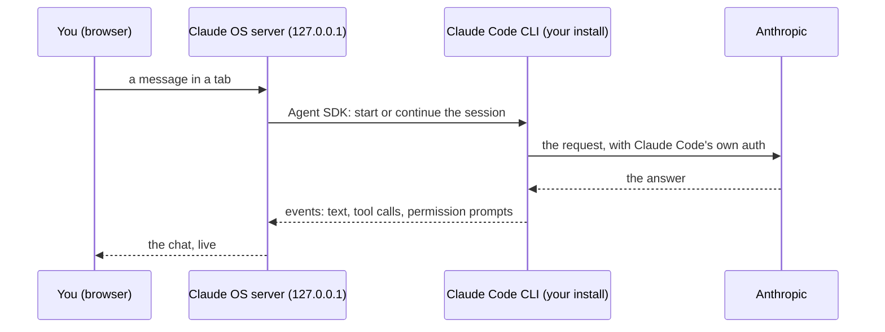

# Claude OS and your Claude account

Claude OS is a local interface for the Claude Code you already have installed. This page says plainly what it does with your Claude account, what it does not do, and which terms apply. It is not legal advice; Anthropic's terms are Anthropic's to interpret.

## The short version

- **It runs on your computer.** The Claude OS server listens on `127.0.0.1` and is used by you, on your machine. There is no hosted Claude OS service.
- **It uses your own Claude Code.** Every session is your `claude` binary, started through Anthropic's official [Claude Agent SDK](https://code.claude.com/docs/en/agent-sdk/overview), with the login or API key you configured for Claude Code yourself.
- **It never touches your credentials.** Claude OS does not offer a login, does not read, copy or store tokens or keys, and does not proxy, pool, share or resell access to Claude.
- **It is an add-on, not a replacement.** Claude OS adds an interface and local tools around Claude Code: tabs, a session list, memory, analytics, kanban. The model, the agent loop, the tools and the permission system are Claude Code's.
- **It is unofficial.** Claude OS is an independent open-source project, not made, endorsed or supported by Anthropic.

## What travels where

Claude OS only ever talks to the Claude Code process on the same machine. The request to Anthropic is made by Claude Code, with Claude Code's authentication, exactly as when you type in a terminal.

| Claude OS does | Claude OS does not |
| --- | --- |
| Start Claude Code sessions in your project folders through the Agent SDK | Ask for, read or store your Claude password, OAuth token or API key |
| Read the journals, settings, skills and MCP config Claude Code keeps under `~/.claude` | Send your data anywhere except through Claude Code, to Anthropic |
| Show your plan name and usage limits as Claude Code reports them | Offer "Log in with Claude" or share one account between people |
| Append a short block to the system prompt: your name and reply language, the project's state note, the rules for memory notes | Change Claude Code's own system prompt, model behaviour or safety settings |
| Give sessions a local MCP server with panel tools (notifications, planner, kanban, documents) | Run anything on a remote server; there is none |

## Which terms apply

Your use of Claude through Claude OS is the same use as through the `claude` command, so the same agreement covers it:

- with a Claude Pro or Max subscription: Anthropic's [Consumer Terms](https://www.anthropic.com/legal/consumer-terms);
- with an API key, Team or Enterprise: Anthropic's [Commercial Terms](https://www.anthropic.com/legal/commercial-terms);
- in both cases: the [Usage Policy](https://www.anthropic.com/legal/aup).

The Claude Agent SDK, which Claude OS uses as a library, is governed by Anthropic's Commercial Terms.

### About subscription login

The Agent SDK documentation says:

> Unless previously approved, Anthropic does not allow third party developers to offer claude.ai login or rate limits for their products, including agents built on the Claude Agent SDK.

Claude OS is designed around this. It has no login of its own and offers none: it does not ship, broker or relay Claude access to anyone. You install Claude Code, you log in to Claude Code yourself, and Claude OS on your own computer starts that Claude Code for you, the same as a terminal or a script would.

Whether a particular personal setup fits Anthropic's terms is for Anthropic to decide, and their policies can change. If you want no ambiguity at all, or you use Claude OS at work, use an API key.

## Using an API key

Claude OS uses whatever authentication Claude Code uses, so any of Claude Code's own methods works:

- export `ANTHROPIC_API_KEY` in the shell before `npm start` (the server passes its environment to every session);
- or set `apiKeyHelper` or `env` in `~/.claude/settings.json`, which Claude OS reads and passes to its sessions.

The title bar then shows API billing instead of a plan. See [Claude Code authentication](https://code.claude.com/docs/en/iam) for the details of each method.

## Branding

The Agent SDK [branding guidelines](https://code.claude.com/docs/en/agent-sdk/overview#branding-guidelines) ask that a product keep its own branding and not appear to be Claude Code or another Anthropic product. Claude OS does not call itself Claude Code, does not copy Claude Code's look, and says on its front page that it is unofficial and powered by Claude Code. The project name contains "Claude"; if Anthropic asks for a different name, the project will be renamed. "Claude" and "Claude Code" are trademarks of Anthropic, PBC.

## If something here is wrong

If Anthropic's terms change or you see a mismatch between this page and how Claude OS behaves, please [open an issue](https://github.com/DezareD/claude-os/issues). The code that starts sessions is in `server/chat/session.ts`; the code that reads plan and limits is in `server/tools/account.ts`.
