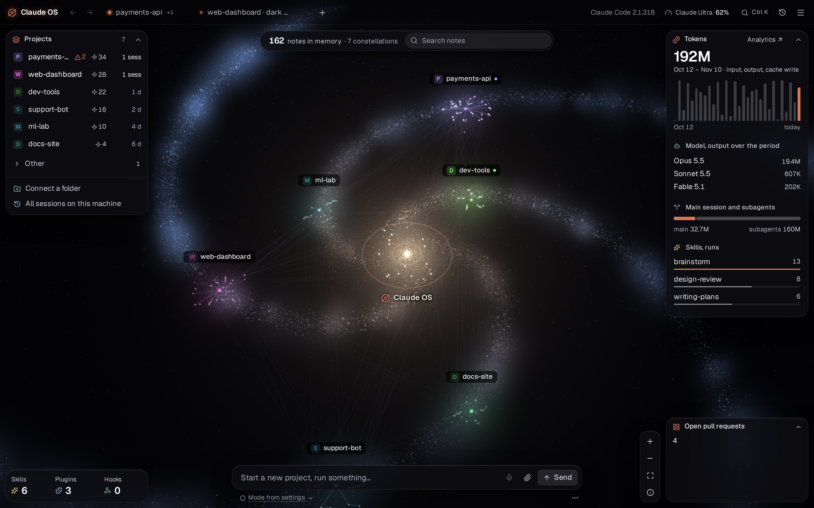
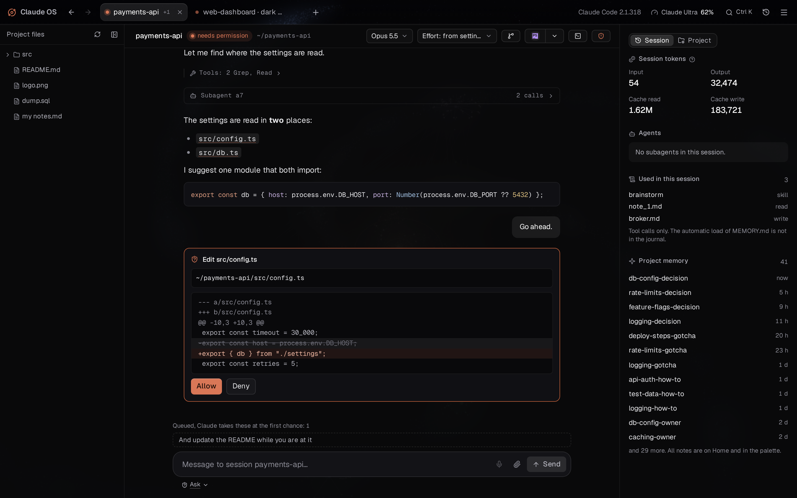
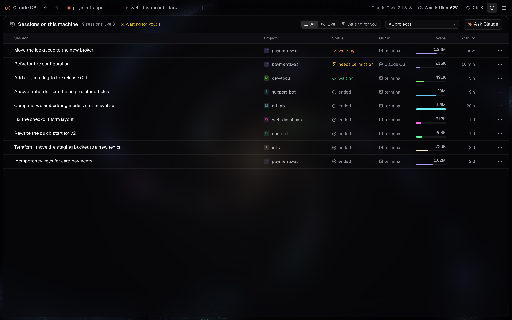
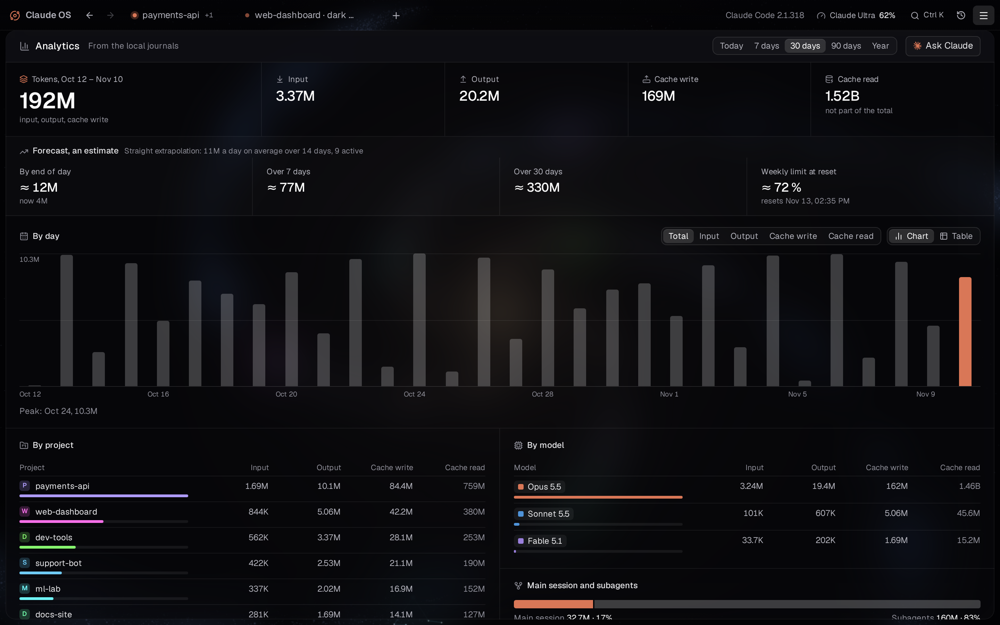
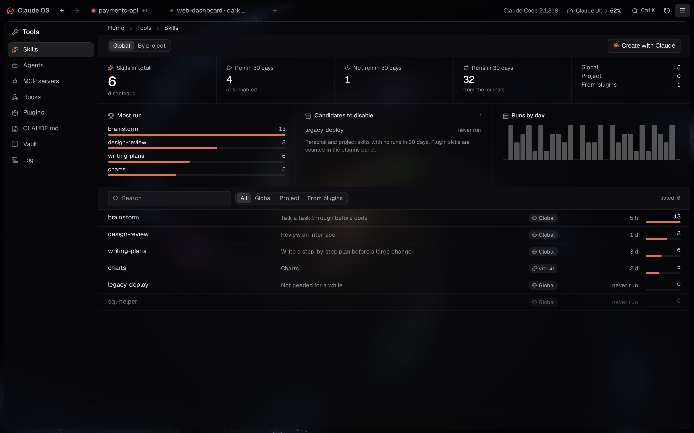
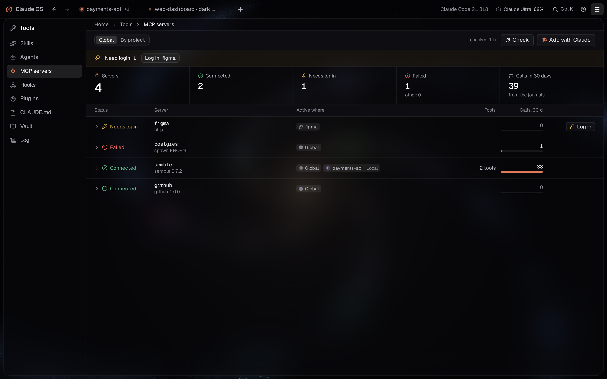
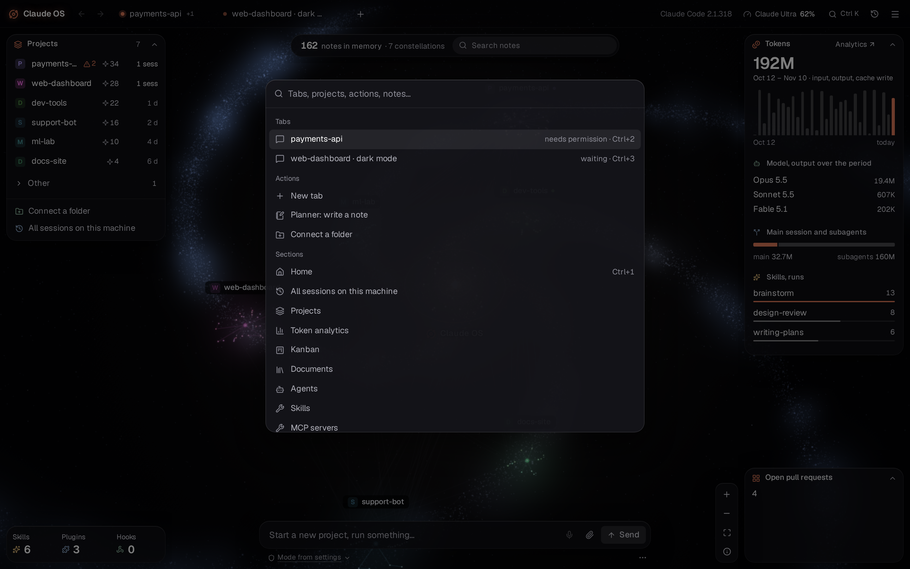

# Features

A tour of the screens. The screenshots come from a mock backend with made-up projects (`npm run demo:media`); your own screens show your data.

## Home

- **Projects panel.** Every folder Claude Code has worked in, found from its journals, with live sessions, memory notes and last activity. Pin, colour, nest or hide projects; connect a folder that has no sessions yet.
- **The map.** Memory notes as stars around their projects, linked notes as lines, the Claude OS core in the middle. Search notes from the bar on top, open one with a click.
- **Side panels.** Tokens for the period, output by model, main session vs subagents, most-run skills, and your widgets.
- **The composer** talks to the root session: "start a project for a Telegram bot", "what is waiting for me", "open three tabs and review these PRs".
- **Title bar.** Tabs with their status (working, waiting for permission, queued messages), your plan and how much of the current limit is used, the command palette, all sessions and the menu.

## Work tabs

- A tab is a Claude Code session in a project folder. Open as many as you need; each keeps its own context.
- **Chat.** Markdown, code, images, tool calls folded into one line, subagents grouped with their calls, a live "Claude is working" line with a stop button.
- **Permissions.** Edits come with the diff; Allow or Deny in one click. Questions (`AskUserQuestion`) and plans (`ExitPlanMode`) get their own cards.
- **Queue.** Write while Claude works; the message waits and goes in at the first chance. Edit or remove it before it does.
- **Per-tab model and effort**, permission mode, and an optional **git worktree**, so two tasks in one repository do not step on each other. A warning appears when another tab works in the same folder.
- **Files and git.** A project tree, a git panel with status, diffs, staging, commits, branches and the log.
- **Slash commands** from Claude Code, your skills and plugins, with their hints. Commands that only exist as a terminal screen run in a background terminal and show that screen.
- **Voice input.** Press the microphone and speak; a local Whisper model turns speech into text, optionally one item per pause. Audio stays on the machine.
- **Side panel.** Session tokens, running subagents, the skills and notes the session used, the project's memory.
- **Open in a terminal.** The same session in `claude --resume`, or a fork of it.

## Sessions

All Claude Code sessions on this machine, including ones started in a terminal: title, project, status, origin, tokens, last activity. Filter by live or "waiting for you" and by project. Expand a session for its subagents, open it read-only, resume it in a tab, stop it, or move it to the trash.

## Analytics

Tokens from the local journals: today, 7, 30 or 90 days, a year. Input, output, cache write and cache read; by day as a chart or a table; by project, model, source (the root session, the service session, widgets) and top sessions. A straight-line forecast for the day, the week and the month, and where the weekly limit will be at reset.

## Tools

| Skills | MCP servers |
| --- | --- |
|  |  |

- **Skills.** Global, per project and from plugins: how often each ran in 30 days, which never ran (candidates to disable), runs by day. Read, edit, disable or create one with Claude.
- **Agents.** Your subagent definitions and how often they were used.
- **MCP servers.** Status per server and per project (connected, needs login, failed), their tools, calls over 30 days, servers that were called but are no longer configured. Check them all, log in, add one with Claude.
- **Hooks** and **Claude Code plugins**, with what each one adds.
- **CLAUDE.md.** The global, root and project instruction files in one place, editable with conflict detection.
- **Vault.** The memory folder: notes per project, broken links, notes that break the note rules; move a project's Claude Code memory into the vault.
- **Log.** Every change Claude OS made to your configuration, with the diff.

## Command palette

<kbd>Ctrl</kbd>+<kbd>K</kbd>: jump to a tab, a project, a section or a note, or run an action. <kbd>Ctrl</kbd>+<kbd>1</kbd>…<kbd>9</kbd> switch tabs.

## Memory

Claude Code's auto-memory, kept in one folder (`vault/`) instead of one hidden folder per project. Notes are plain Markdown with front matter and `[[links]]`, so the vault opens in Obsidian. Search them from the map or the palette, open and edit them in place, and see which notes a session read or wrote.

## Kanban and planner

- **Kanban.** Cards per project in Backlog, Up next, In progress, Polish, Done. Claude can take a card, move it and add notes through its tools; you drag cards with the mouse or the keyboard.
- **Planner.** A side panel for quick notes. The service session files a note: splits it into items, gives it a title and a folder.

## Documents

Reports, plans and other documents Claude writes are saved as Claude OS documents, per project, with search and filters, instead of loose files in your repositories.

## Widgets and actions

- **Widgets** on the home screen show the output of a shell command on a timer, as text or with their own React view. Ask Claude for one in plain words.
- **Actions** are buttons in a work tab that run a command for that project: run the tests, deploy, open a terminal.
- Both run only after you approve the exact command text.

## Claude OS plugins

Packages with skills, hooks, MCP servers and interface code, off until you enable them. Shipped:

| Plugin | What it adds |
| --- | --- |
| IDE+ | A light editor over the project file panel: edit code in place, view images, SVG, video and audio |
| Project kit | A development kit for your own repositories: a short CLAUDE.md from the project's real commands, workflow rules, one check script, hooks, agents and skills; nothing is written before you approve the plan |
| rg-context | Context search on top of ripgrep for Claude: files ranked by matches, within an output budget |
| Claude OS builder | Skills that teach Claude to build widgets, plugins and actions for Claude OS |
| Agentation | Notes on Claude OS's own interface, bound to elements, for Claude to act on (third-party, PolyForm Shield license) |

## Settings

Language, profile (name, reply language, projects folder, how often Claude asks), home widgets, IDEs and programs found on the machine, projects, the Claude account (plan, limits, version, `claude doctor`), notes and Obsidian, voice input, about.

## Desktop app

On Windows: a native window with a tray icon and system notifications when a tab needs you. It starts the server in WSL when needed, restarts an idle server after an update, and leaves the server running when you close the window.
