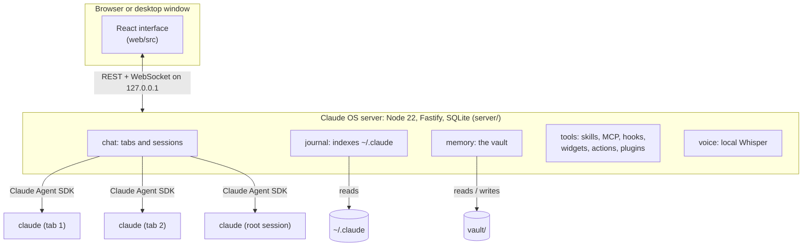

# How it works

## The pieces

| Part | Where | What it is |
| --- | --- | --- |
| Server | `server/` | TypeScript run directly by Node (type stripping, no build). Fastify for HTTP, a WebSocket for live events, `node:sqlite` for the session index. |
| Interface | `web/src/` | React 19, Vite, Tailwind. `npm run build` writes `dist/web`, which the server serves. |
| Shared types | `shared/` | The API contract both sides import. |
| Desktop shell | `desktop/` | Electron for Windows: a window over the same web interface, a tray, notifications. |
| Prompts | `root/`, `service/`, `setup/` | The folders and `CLAUDE.md` of the sessions Claude OS runs for itself. |
| Plugins | `plugins/` | Shipped Claude OS plugins; your own go in `config/plugins/`. |

## The sessions Claude OS runs

Every session is a real Claude Code process, started with Claude Code's own system prompt and your user, project and local settings, so your skills, MCP servers, hooks and `CLAUDE.md` files apply as in a terminal.

- **Work tabs.** One per task, in a project folder, optionally in its own git worktree. Permission prompts, questions and plans from Claude Code appear in the tab; nothing is auto-approved beyond the permission mode you chose.
- **The root session.** The composer on the home screen. It has extra tools to open tabs, start projects, hand jobs to the service session and restart the server. It is a coordinator: it answers quickly and hands longer work in a project to tabs.
- **The service session.** Hidden; does short background jobs for the interface, such as filing a planner note, and reports back.
- **The setup session.** Runs the first-run talk and saves your profile.

To each session Claude OS appends a short block to the system prompt (your name and reply language, the project's state note, the rules for memory notes) and connects a local MCP server with panel tools: notifications, progress, the planner, kanban and documents.

Sessions started anywhere else, for example in a terminal, are not controlled by Claude OS. It reads their journals to list them, show their transcript and count their tokens, and can stop them on request.

## Security model

Claude OS can run commands on your machine through Claude Code, so it is built to be reachable only by you:

- **Loopback only.** The server binds to `127.0.0.1`. It is not reachable from the network.
- **Host and Origin checks.** Every request must name `127.0.0.1:<port>` or `localhost:<port>` as its host, which stops DNS rebinding; browser requests from another origin are refused.
- **A token cookie.** A random 256-bit token is created on the first start (`data/token`, mode `0600`). The `/auth?token=` link exchanges it for an `HttpOnly` cookie; every request and the WebSocket need it.
- **Approved commands only.** Widgets and actions run shell commands. A command runs only after you approve its exact text in the interface; the approval is a hash stored in `data/`. Editing `config/` does not approve anything, so a session that rewrites a widget cannot make it run.
- **Claude Code's permissions stay in charge.** Claude OS shows Claude Code's permission prompts and passes your answer back. It does not widen what a session may do.
- **Plugins are off until enabled**, and a plugin's dependency check may only probe addresses on this machine.

Report a vulnerability as described in [SECURITY.md](../../SECURITY.md).

## Network

The server itself makes no requests to the internet: no telemetry, no analytics, no update checks. Outbound traffic comes from:

- Claude Code, to Anthropic, as usual;
- the voice model download (Whisper, from Hugging Face), only when you turn voice input on;
- the Electron runtime download, only when you build the desktop app;
- `npm install`, `git pull`, and whatever you or Claude run in your projects.

## Data

| Folder | What | Tracked by git |
| --- | --- | --- |
| `config/` | Settings, profile, widgets, actions, your plugins | no |
| `data/` | Session index, app state, documents, planner, uploads, backups, the token, approvals | no |
| `vault/` | Memory notes and kanban cards, Obsidian-compatible Markdown | no |
| `~/.claude` | Claude Code's own journals and settings | read; written only for changes you make through the panel (a skill, an MCP server, a hook) |

`defaults/` ships the default settings, widgets and actions. On start, missing keys and new shipped records are added to `config/` once; a value you changed is never overwritten.

## Extending

- **Widgets**: a shell command for the data and, if you want, a React view in its own file. Ask Claude on the home screen; the `os-builder` plugin teaches it how.
- **Actions**: buttons in a work tab that run a command for that project.
- **Claude OS plugins**: a manifest with skills, hooks, MCP servers and interface code. See the shipped ones in `plugins/`.
- **A new language**: one file in `web/src/lib/locales/`.
